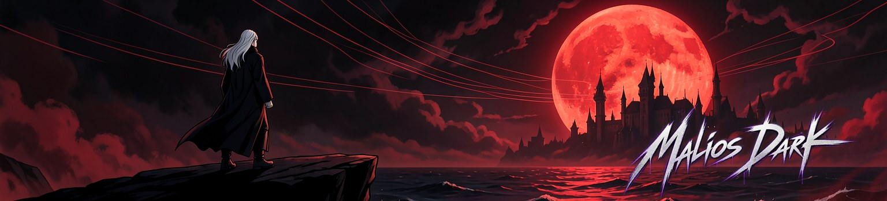
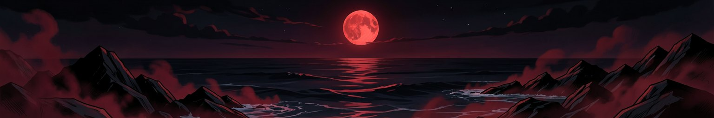

<!-- Perfil de GitHub de Malios Dark (15 nov 2026, v3: lo nuestro + lo de Grok, sin Featured y sin ciudad). Va con assets/darkstation.svg -->

---

### 🌑 About

I make things. If I want it and it doesn't exist yet, I build it.

I live at the crossroads of **AI, wireless sensing, security and multimedia**: estimating 3D human pose using only WiFi signals, private communication protocols, LoRa mesh networks, firmware for boards nobody supports, tiny language models trained from scratch, and full-stack apps, while also producing electronic music and building AI visual worlds as **Malios Dark**.

All of it from one home workstation and a single GPU.

**Currently exploring**
- 📡 Real-time spatial awareness through WiFi CSI + deep learning
- 🔐 Decentralized & private communication protocols
- 🧬 Low-level research (XNU / SPTM / reverse engineering)
- 🧠 Small language models trained from zero
- 🎬 Music × AI: music videos, an animated series and a fighting game with my own characters

---

### 🛠️ Tech & Domains

| | |
|---|---|
| 🧠 **AI & Sensing** | PyTorch · TensorFlow · WiFi CSI · Computer Vision · Local LLMs · Text-to-Image · Video generation |
| 📡 **Wireless & Security** | Rust · ESP32 · STM32 · LoRa · Pwnagotchi · MikroTik · pfSense · Firewalls · Reverse Engineering |
| 🌐 **Systems & Full-Stack** | TypeScript · React · Node.js · Django · Laravel · Docker · Kubernetes · PostgreSQL · Redis |
| 🎵 **Creative** | Electronic Music Production · Digital Art · AI Visual Worlds · Animation |

---

### 📊 Stats

---

### 🎵 Music & Worlds

I release music and create AI-driven visual experiences under **Malios Dark**.

- [Official Site](https://maliosdark.com)  music, videos, AI worlds and the animated series
- [Spotify](https://open.spotify.com/artist/3pyejzcfWokW7LYE2xGUPH)
- [YouTube](https://www.youtube.com/@MaliosDark)

---

### 🔗 Connect

  

